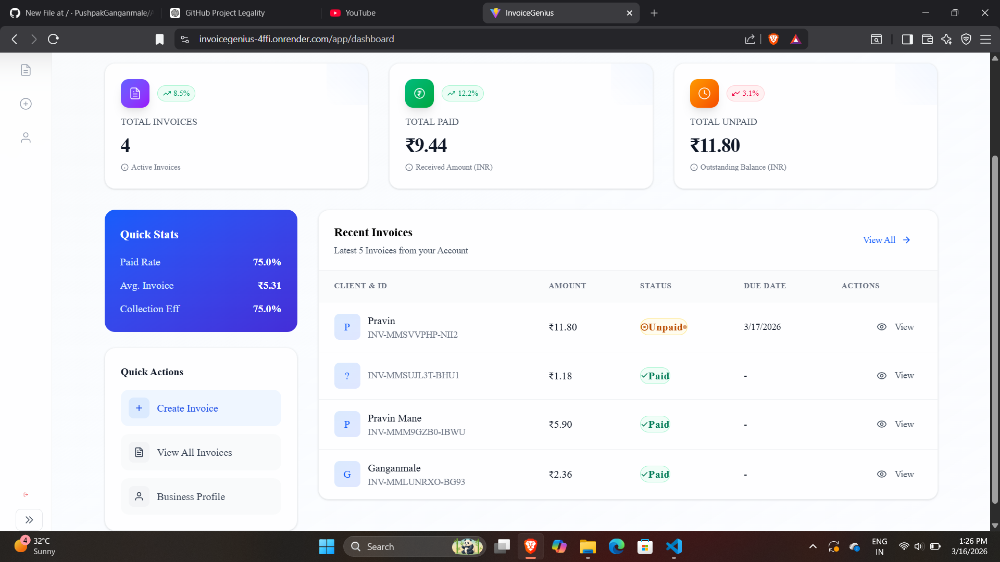
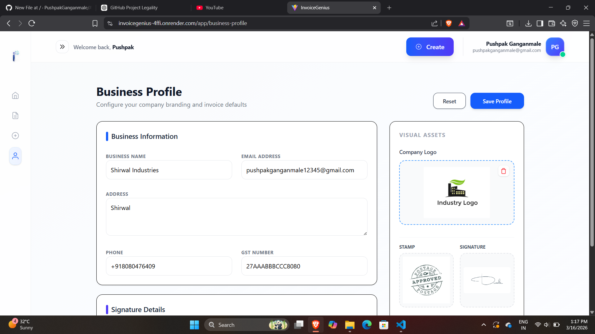
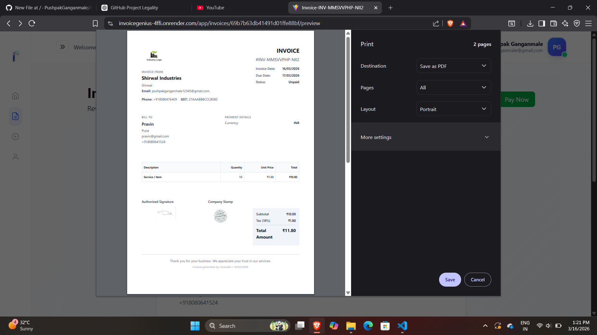
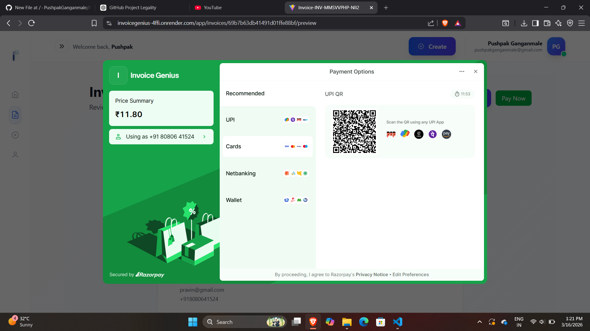

# AI Invoice Generator — MERN + AI + Razorpay

A full-stack SaaS application for creating, managing, and tracking professional invoices with AI-powered invoice assistance and online payments.

## 📘 Contents

- About the Project
- Features
- Tech Stack
- Architecture
- Screenshots
- Live Demo
- Installation
- Environment Variables
- Run Locally
- Folder Structure
- Future Improvements
- Author

---

## ⭐ About the Project

**AI Invoice Generator** is a full-stack SaaS web application built using the **MERN stack**, **Clerk authentication**, **GROQ AI**, and **Razorpay**.

The application helps freelancers and businesses create professional invoices, manage invoice records, maintain business information, and accept online payments.

### Users can:

- Create and manage invoices
- Automatically calculate taxes and totals
- Track invoice payment status
- Accept online payments using Razorpay
- Store and manage business profile information
- Add a business logo, signature, and stamp
- Generate invoice descriptions with AI
- Preview invoices before generating/exporting them
- Manage invoices from a centralized dashboard

This project demonstrates a complete full-stack SaaS application with authentication, database management, AI integration, and payment processing.

---

## ✨ Features

### 🎨 Frontend

- Modern and responsive UI using **React.js**
- Styled with **TailwindCSS**
- Responsive dashboard
- Invoice creation interface
- Live invoice preview
- Business profile management
- Invoice listing and management
- User authentication with Clerk

---

## 🧾 Invoice Management

Users can:

- Create invoices
- Edit invoices
- Delete invoices
- Automatically calculate totals
- Calculate taxes
- Track invoice status
- Preview invoices
- Export invoices as PDF

### Invoice Statuses

```text
draft
unpaid
partially_paid
paid
overdue
```

---

## 💳 Online Payments

The application integrates **Razorpay** for online invoice payments.

### Payment Features

- Create Razorpay payment orders
- Pay invoices online
- Track payment status
- Update invoice payment records
- Secure payment processing

---

## 🧠 AI Features

AI functionality is powered by the **GROQ API**.

### AI Capabilities

- AI-generated invoice descriptions
- Smart invoice item suggestions
- AI-assisted invoice creation
- Faster invoice content generation

---

## 🏢 Business Profile

Users can configure their business information, including:

- Business name
- GST number
- Address
- Contact details
- Company logo
- Signature
- Stamp

The configured business information can be used while creating invoices.

---

## 🔐 Authentication

Authentication is implemented using **Clerk**.

Features include:

- User sign-in
- User sign-up
- Protected application routes
- Authenticated API requests
- User-specific invoice management

---

## 🧰 Tech Stack

| Layer | Technologies |
|------|-------------|
| Frontend | React.js, Vite, TailwindCSS |
| Backend | Node.js, Express.js |
| Database | MongoDB, Mongoose |
| Authentication | Clerk |
| Payments | Razorpay |
| AI | GROQ API |
| Deployment | Vercel, Render |
| Version Control | Git, GitHub |

---

## 🧱 Architecture

```text
                    ┌─────────────────────┐
                    │      React.js       │
                    │  Vite + TailwindCSS │
                    │       Vercel        │
                    └──────────┬──────────┘
                               │
                               │ REST API
                               ▼
                    ┌─────────────────────┐
                    │   Node.js + Express │
                    │       Render        │
                    └──────┬──────┬───────┘
                           │      │
                 ┌─────────┘      └──────────┐
                 ▼                           ▼
        ┌─────────────────┐          ┌─────────────────┐
        │ MongoDB Atlas   │          │   GROQ AI       │
        │    Database     │          │  AI Services    │
        └─────────────────┘          └─────────────────┘
                           │
                           ▼
                    ┌─────────────────┐
                    │    Razorpay     │
                    │ Payment Gateway │
                    └─────────────────┘
```

---

## 🖼 Screenshots

Add your project screenshots inside the `screenshots` folder.

| Dashboard | Business Profile |
|-----------|------------------|
|  |  |

| Invoice | Payment |
|---------|---------|
|  |  |

> If your screenshot filenames are different, update the paths above to match the actual files in the `screenshots` folder.

---

## 🌐 Live Demo

### Frontend

https://ai-invoice-generator-saas.vercel.app/

### Backend API

https://ai-invoice-generator-saas-1.onrender.com

### Backend Health Check

https://ai-invoice-generator-saas-1.onrender.com/api/health

### GitHub Repository

https://github.com/AbhinavRaskar/AI_invoice_generator-SAAS.git

---

## 🔧 Installation

### 1. Clone the Repository

```bash
git clone https://github.com/AbhinavRaskar/AI_invoice_generator-SAAS.git
cd AI_invoice_generator-SAAS
```

### 2. Install Frontend Dependencies

```bash
cd frontend
npm install
```

### 3. Install Backend Dependencies

```bash
cd ../backend
npm install
```

---

## 🔑 Environment Variables

### Backend

Create a `.env` file inside the `backend` folder:

```env
PORT=4000

MONGO_URI=your_mongodb_connection_string

RAZORPAY_KEY_ID=your_razorpay_key_id
RAZORPAY_KEY_SECRET=your_razorpay_key_secret

GROQ_API_KEY=your_groq_api_key

GEMINI_API_KEY=your_gemini_api_key

FRONTEND_URL=http://localhost:5173
```

For production, set:

```env
FRONTEND_URL=https://ai-invoice-generator-saas.vercel.app
```

### Frontend

Create a `.env` file inside the `frontend` folder:

```env
VITE_API_BASE=http://localhost:4000
```

For the deployed frontend, configure:

```env
VITE_API_BASE=https://ai-invoice-generator-saas-1.onrender.com
```

> Never commit `.env` files or API keys to GitHub.

---

## ▶ Run Locally

### Start the Backend

Open a terminal:

```bash
cd backend
npm run dev
```

The backend runs locally on:

```text
http://localhost:4000
```

### Start the Frontend

Open another terminal:

```bash
cd frontend
npm run dev
```

The frontend runs locally on:

```text
http://localhost:5173
```

---

## 🏗️ Production Build

To create a production build of the frontend:

```bash
cd frontend
npm run build
```

The production files are generated inside:

```text
frontend/dist
```

---

## 📂 Folder Structure

```text
AI_invoice_generator-SAAS/
│
├── backend/
│   ├── config/
│   ├── controllers/
│   ├── models/
│   ├── routes/
│   ├── uploads/
│   ├── server.js
│   └── package.json
│
├── frontend/
│   ├── public/
│   ├── src/
│   │   ├── component/
│   │   ├── pages/
│   │   └── ...
│   ├── package.json
│   └── vite.config.js
│
├── screenshots/
│
├── .gitignore
├── LICENSE.md
└── README.md
```

---

## 🚀 Deployment

### Frontend — Vercel

The React/Vite frontend is deployed on **Vercel**.

```text
https://ai-invoice-generator-saas.vercel.app/
```

### Backend — Render

The Node.js/Express backend is deployed on **Render**.

```text
https://ai-invoice-generator-saas-1.onrender.com
```

### Database — MongoDB Atlas

MongoDB Atlas is used as the cloud database.

The backend connects to MongoDB using the `MONGO_URI` environment variable.

---

## 🧪 Future Improvements

- Recurring invoices
- Email invoice sending
- Invoice analytics dashboard
- Multi-currency support
- More invoice templates
- Team collaboration
- Automated payment reminders
- Cloud storage for uploaded files
- Advanced financial reports
- Invoice sharing through public links

---

## 👨‍💻 Author

### Abhinav Raskar

**Full Stack Developer | MERN Stack Developer**

- GitHub: https://github.com/AbhinavRaskar
- Project Repository: https://github.com/AbhinavRaskar/AI_invoice_generator-SAAS
- Live Project: https://ai-invoice-generator-saas.vercel.app/

---

## ⭐ Project Highlights

- Full-stack MERN SaaS application
- AI-powered invoice generation
- Clerk authentication
- Razorpay payment integration
- MongoDB Atlas database
- Responsive React dashboard
- RESTful backend APIs
- Production deployment using Vercel and Render

---

## 📄 License

This project is licensed under the terms specified in `LICENSE.md`.
